# LAPORAN PRAKTIK DASAR PEMROGRAMAN

## Jobsheet 11 — Array 2 Dimensi (2-Dimensional Arrays)

| | |
|---|---|
| **Mata Kuliah** | Dasar Pemrograman 2026 (Pertemuan 12 / Minggu 10) |
| **Nama** | M Thoriq Aadila Diemietriech |
| **No. Absen** | 20 |
| **Program Studi** | D4 Teknik Informatika (Semester 1) |
| **Institusi** | Politeknik Negeri Malang |
| **Kelas** | 1I |
 

---

## 1. Tujuan Praktik

1. Mendeklarasikan, membuat (instansiasi), dan menginisialisasi array 2 dimensi di Java.
2. Mengakses dan mengisi elemen array 2 dimensi dengan indeks baris dan kolom.
3. Memproses array 2 dimensi dengan *nested loop* memakai `for` maupun `foreach`.
4. Membuat array 2 dimensi yang panjang barisnya berbeda-beda (*jagged array*).
5. Menghitung rata-rata per baris dan rata-rata per kolom pada studi kasus nyata.

## 2. Dasar Teori Singkat

- **Array 2 dimensi** adalah array yang elemen-elemennya adalah array lagi. Jadi `audience[i]` adalah satu **baris** (array 1 dimensi), dan `audience[i][j]` adalah elemen pada **kolom** `j` di baris `i`. Indeks selalu mulai dari `0`.
- `arr.length` = jumlah baris. `arr[i].length` = jumlah kolom pada baris ke-`i`.
- **Deklarasi:** `String[][] audience = new String[4][2];` membuat 4 baris × 2 kolom. Elemen berisi nilai default (`0` untuk `int`, `null` untuk `String`).
- ***Jagged array*:** `int[][] a = new int[3][];` lalu tiap baris dibuat sendiri, misalnya `a[0] = new int[5];`, sehingga panjang tiap baris boleh berbeda.
- **Nested loop:** loop luar menelusuri baris, loop dalam menelusuri kolom pada baris tersebut.
- `Arrays.toString()` hanya untuk 1 dimensi; array 2 dimensi memakai `Arrays.deepToString()`.
- Panjang array **tidak dapat berubah** setelah dibuat.

## 3. Alat dan Cara Menjalankan

- JDK dan editor teks/IDE (Visual Studio Code).
- Kompilasi dan eksekusi dari terminal, contoh untuk Percobaan 1:

```bash
javac Cinema20.java
java Cinema20
```

> Nomor absen saya **20**, sehingga `<StudentNo>` pada nama file diganti `20` (contoh: `Cinema20.java`, kelas `Cinema20`).
> Folder `src/` berisi seluruh source code, dan folder `image/` berisi tangkapan layar hasil eksekusi.

---

## 4. Percobaan 1 — Deklarasi, Inisialisasi, dan Menampilkan Array 2 Dimensi

Studi kasus: penonton bioskop mini dengan 4 baris dan 2 kolom kursi.

**File:** `src/percobaan1/Cinema20.java` (Langkah 1–4)

```java
public class Cinema20 {
    public static void main(String[] args) {
        // Langkah 2: array String 4 baris x 2 kolom
        String[][] audience = new String[4][2];

        // Langkah 3: isi setiap elemen
        audience[0][0] = "Amin";
        audience[0][1] = "Bena";
        audience[1][0] = "Candra";
        audience[1][1] = "Dela";
        audience[2][0] = "Eka";
        audience[2][1] = "Farhan";
        audience[3][0] = "Gisel";
        audience[3][1] = "Hana";

        // Langkah 4: tampilkan semua elemen
        System.out.printf("%s \t %s\n", audience[0][0], audience[0][1]);
        System.out.printf("%s \t %s\n", audience[1][0], audience[1][1]);
        System.out.printf("%s \t %s\n", audience[2][0], audience[2][1]);
        System.out.printf("%s \t %s\n", audience[3][0], audience[3][1]);
    }
}
```

**Hasil eksekusi**


Hasil sesuai *checkpoint* jobsheet: kedelapan nama tercetak, dua nama per baris.

### Jawaban Pertanyaan Percobaan 1

**1. Apakah elemen array harus diisi berurutan mulai dari indeks 0?**

Tidak harus. Elemen array diakses langsung lewat indeksnya, sehingga boleh diisi dalam urutan apa pun, misalnya `audience[3][1]` lebih dulu daripada `audience[0][0]`. Elemen yang belum diisi tetap berisi nilai default (`null` untuk `String`). Urutan baru berpengaruh bila program memang mengandalkan urutan, misalnya saat menelusuri dengan loop.

**2. Jika baris `audience[3][1] = "Hana";` dijadikan komentar, apa yang tercetak untuk baris ke-4?**

File: `src/percobaan1/Cinema20Q2.java` (hanya baris `audience[3][1] = "Hana";` yang diberi `//`).

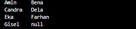

Baris ke-4 tercetak `Gisel    null`. Array `String` adalah array objek (referensi), dan nilai default elemen bertipe objek adalah `null`. Elemen `audience[3][1]` tidak pernah diisi sehingga tetap `null`, dan `printf` dengan `%s` mencetak `null` sebagai teks "null".

**3. Mengapa penting mengisi semua elemen sebelum array ditampilkan?**

Elemen yang belum diisi bernilai `null`. Jika hanya dicetak, hasilnya tampil sebagai kata "null" yang menyesatkan. Lebih berbahaya lagi, jika memanggil method pada elemen tersebut (misalnya `audience[3][1].length()` atau `.toUpperCase()`), program berhenti dengan `NullPointerException`. Maka data harus lengkap, atau elemen `null` harus ditangani secara eksplisit (misalnya diganti `***`, seperti pada Percobaan 2).

**4. Tujuan `audience.length` dan `audience[0].length`.**

File: `src/percobaan1/Cinema20Q4.java` (menambahkan Code 6 setelah Langkah 4).

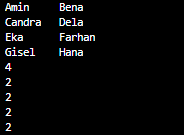

- `audience.length` = **jumlah baris** array (4).
- `audience[0].length` = **jumlah kolom pada baris pertama** (2), karena `audience[0]` sendiri adalah array 1 dimensi.

Output tambahan: `4`, `2`, `2`, `2`, `2`.

**5. Apakah `audience[0].length` sampai `audience[3].length` bernilai sama? Mengapa?**

Ya, semuanya `2`. Array dibuat dengan `new String[4][2]` sehingga setiap baris otomatis dibuat dengan panjang yang sama (array persegi panjang/*rectangular*). Pada *jagged array* (Percobaan 3) panjang tiap baris boleh berbeda.

**6 dan 7. Panjang tiap baris dengan `for` dan `foreach`.**

File: `src/percobaan1/Cinema20Q6Q7.java`

```java
// Code 7: for
for (int i = 0; i < audience.length; i++) {
    System.out.println("Length of row " + (i + 1) + ": " + audience[i].length);
}

// Code 8: foreach
for (String[] rowAudience : audience) {
    System.out.println("Row length: " + rowAudience.length);
}
```

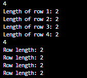

Keduanya menghasilkan panjang `2` untuk keempat baris. Pada `foreach`, tipe variabel loop adalah `String[]` (satu baris utuh), bukan `String`, karena elemen dari `audience` adalah array baris.

**8, 9, dan 10. Penonton baris ke-3 (`for`, `foreach`) dan semua baris (`String.join()`).**

File: `src/percobaan1/Cinema20Q8Q10.java`

```java
// Code 9: for
for (int i = 0; i < audience[2].length; i++) {
    System.out.println(audience[2][i]);
}

// Code 10: foreach
for (String name : audience[2]) {
    System.out.println(name);
}

// Code 11: semua baris dengan String.join()
for (int i = 0; i < audience.length; i++) {
    System.out.println("Audience in row " + (i + 1) + ": " + String.join(", ", audience[i]));
}
```

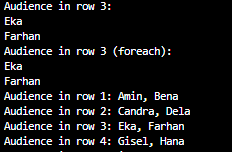

**11. Kelebihan dan kekurangan `foreach` dibanding `for`.**

| | `foreach` | `for` dengan indeks |
|---|---|---|
| Kelebihan | Lebih ringkas dan mudah dibaca; tidak perlu mengatur batas, sehingga terhindar dari kesalahan *off-by-one* dan `ArrayIndexOutOfBoundsException` | Memiliki indeks `i`: dapat menampilkan nomor baris/kolom, menelusuri sebagian atau terbalik, dan membandingkan elemen bertetangga |
| Kekurangan | Tidak tersedia indeks (nomor baris perlu penghitung manual); variabel loop adalah salinan sehingga tidak dapat dipakai untuk mengisi atau mengganti elemen array; selalu menelusuri seluruh elemen | Lebih panjang dan rawan kesalahan batas (`<` vs `<=`) |

**12. Indeks baris maksimum array `audience`, dan asal nilainya.**

Indeks baris maksimum adalah **3**. Nilainya berasal dari `audience.length - 1`, dengan `audience.length = 4` yang ditentukan oleh dimensi pertama pada `new String[4][2]`.

**13. Indeks kolom maksimum, dan apakah sama untuk semua baris?**

Indeks kolom maksimum adalah **1**, yaitu `audience[i].length - 1` dengan `audience[i].length = 2`. Pada array ini nilainya sama untuk semua baris karena semua baris dibuat dengan panjang yang sama. Pada *jagged array* nilainya bisa berbeda tiap baris, sehingga batas kolom harus diambil dari `array[i].length`.

**14. Fungsi `String.join()` dan parameternya.**

`String.join(delimiter, elements)` menggabungkan sejumlah string menjadi satu string, dipisahkan oleh *delimiter*. Parameter pertama adalah pemisah (`", "`), parameter kedua adalah kumpulan string yang digabung (di sini array `audience[i]`). Contoh hasil: `Amin, Bena`. Elemen yang `null` akan ikut tergabung sebagai teks "null".

### Pertanyaan Diskusi Percobaan 1

File: `src/percobaan1/Cinema20Discussion.java`

```java
import java.util.Arrays;

public class Cinema20Discussion {
    public static void main(String[] args) {
        String[][] audience = new String[4][2];

        // 1) ELEMEN yang null: barisnya tetap ada, hanya isinya kosong
        audience[1][0] = "Candra";
        audience[1][0] = null;
        System.out.println("Setelah audience[1][0] = null -> audience[1].length = " + audience[1].length);

        // 2) BARIS yang null: objek array barisnya tidak ada
        audience[1] = null;
        try {
            System.out.println(audience[1].length);
        } catch (NullPointerException e) {
            System.out.println("Setelah audience[1] = null -> NullPointerException");
            System.out.println("Pesan: " + e.getMessage());
        }

        // 3) Menambah baris: panjang array tidak bisa berubah, harus membuat array baru
        String[][] bigger = Arrays.copyOf(audience, audience.length + 1);
        bigger[4] = new String[]{"Ira", "Joko"};
        System.out.println("length lama = " + audience.length + ", length baru = " + bigger.length);
    }
}
```

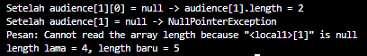

**Baris `null` vs elemen `null`.**
- `audience[1][0] = null;` hanya mengosongkan **satu elemen**. Baris `audience[1]` tetap ada sebagai objek array berpanjang 2, sehingga `audience[1].length` tetap `2`.
- `audience[1] = null;` membuat **baris itu sendiri tidak ada** (tidak menunjuk ke array mana pun). Memanggil `audience[1].length` menghasilkan `NullPointerException`, karena tidak ada objek array yang bisa ditanya panjangnya.

**Apakah `audience.length` dapat berubah? Bagaimana menambah baris?**
Tidak. Panjang array ditetapkan saat dibuat dan tidak dapat diubah. Untuk "menambah" baris harus membuat array **baru** yang lebih besar lalu menyalin isi lama (contoh di program: `Arrays.copyOf(audience, audience.length + 1)`); array lama tetap berukuran 4. Inilah keterbatasan array di Java: ukuran tetap, dan menambah data berarti membuat serta menyalin array baru. Struktur seperti `ArrayList` dibuat untuk mengatasi hal ini.

---

## 5. Percobaan 2 — Scanner dan Perulangan untuk Input/Output Array 2 Dimensi

**File:** `src/percobaan2/CinemaWithScanner20.java` (Langkah 1–2; data penonton diinput dari keyboard)

```java
import java.util.Arrays;
import java.util.Scanner;

public class CinemaWithScanner20 {
    public static void main(String[] args) {
        Scanner sc = new Scanner(System.in);
        int row, col;
        String name, choice;
        String[][] audience = new String[4][2];

        // Langkah 2: isi array memakai Scanner
        while (true) {
            System.out.print("Enter name: ");
            name = sc.nextLine();
            System.out.print("Enter row: ");
            row = sc.nextInt();
            System.out.print("Enter column: ");
            col = sc.nextInt();
            sc.nextLine();   // buang sisa newline di buffer

            audience[row - 1][col - 1] = name;

            System.out.print("Add another audience member? (y/n): ");
            choice = sc.nextLine();

            if (choice.equalsIgnoreCase("n")) {
                break;
            }
        }

        // Tambahan (bukan dari jobsheet): menampilkan isi array agar hasil input terlihat
        System.out.println(Arrays.deepToString(audience));
    }
}
```

> Baris `System.out.println(Arrays.deepToString(audience));` di akhir adalah **tambahan saya** (tidak ada di jobsheet) agar isi array hasil input terlihat. Baris `sc.nextLine();` setelah `nextInt()` berfungsi membuang karakter *newline* yang tersisa di buffer, supaya `nextLine()` berikutnya tidak membaca baris kosong.

**Hasil eksekusi** (sesi contoh dari jobsheet: Agus (1,2), Indah (2,1), Sonya (3,1), Fuady (3,2))

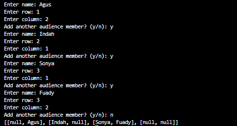

Baris terakhir menunjukkan isi array: baris 3 penuh, baris 4 masih kosong (`null`).

### Jawaban Pertanyaan Percobaan 2

**1. Apakah elemen harus diisi dari Scanner berurutan mulai indeks 0?**

Tidak. Posisi elemen ditentukan oleh nomor baris dan kolom yang diketik pengguna (`audience[row - 1][col - 1] = name`), sehingga kursi (3,2) boleh diisi lebih dulu daripada (1,2). Kursi yang tidak pernah diisi tetap `null` (terlihat pada hasil di atas).

**2 sampai 5. Menu, validasi nomor kursi, pengecekan kursi terisi, dan tampilan `***`.**

Keempat soal ini digabung dalam satu program: `src/percobaan2/CinemaMenu20.java`.

```java
import java.util.Scanner;

public class CinemaMenu20 {
    public static void main(String[] args) {
        Scanner sc = new Scanner(System.in);
        String[][] audience = new String[4][2];
        String choice;

        do {
            // Pertanyaan 2: menu
            System.out.println();
            System.out.println("===== CINEMA MENU =====");
            System.out.println("1. Enter audience data");
            System.out.println("2. Show the audience list");
            System.out.println("3. Exit");
            System.out.print("Choose: ");
            choice = sc.nextLine().trim();

            if (choice.equals("1")) {
                System.out.print("Enter name: ");
                String name = sc.nextLine().trim();

                boolean placed = false;
                while (!placed) {
                    // baca baris (hanya menerima angka)
                    System.out.print("Enter row (1-" + audience.length + "): ");
                    while (!sc.hasNextInt()) {
                        System.out.print("Please enter a number: ");
                        sc.next();
                    }
                    int row = sc.nextInt();

                    // Pertanyaan 3: validasi nomor baris
                    if (row < 1 || row > audience.length) {
                        System.out.println("Row " + row + " does not exist. Valid rows: 1-" + audience.length + ".");
                        continue;
                    }

                    // baca kolom (hanya menerima angka)
                    System.out.print("Enter column (1-" + audience[row - 1].length + "): ");
                    while (!sc.hasNextInt()) {
                        System.out.print("Please enter a number: ");
                        sc.next();
                    }
                    int col = sc.nextInt();
                    sc.nextLine();   // buang sisa newline

                    // Pertanyaan 3: validasi nomor kolom
                    if (col < 1 || col > audience[row - 1].length) {
                        System.out.println("Column " + col + " does not exist. Valid columns: 1-"
                                + audience[row - 1].length + ".");
                        continue;
                    }

                    // Pertanyaan 4: cek kursi sudah terisi
                    if (audience[row - 1][col - 1] != null) {
                        System.out.println("Seat (" + row + "," + col + ") is already taken by "
                                + audience[row - 1][col - 1] + ". Please choose another seat.");
                        continue;
                    }

                    audience[row - 1][col - 1] = name;
                    System.out.println(name + " is seated at (" + row + "," + col + ").");
                    placed = true;
                }

            } else if (choice.equals("2")) {
                // Pertanyaan 5: kursi kosong ditampilkan sebagai ***
                System.out.println();
                System.out.println("===== AUDIENCE LIST =====");
                System.out.printf("%-8s", "");
                for (int j = 0; j < audience[0].length; j++) {
                    System.out.printf("%-10s", "Col " + (j + 1));
                }
                System.out.println();

                for (int i = 0; i < audience.length; i++) {
                    System.out.printf("%-8s", "Row " + (i + 1));
                    for (int j = 0; j < audience[i].length; j++) {
                        String seat = (audience[i][j] == null) ? "***" : audience[i][j];
                        System.out.printf("%-10s", seat);
                    }
                    System.out.println();
                }

            } else if (!choice.equals("3")) {
                System.out.println("Invalid choice, please enter 1-3.");
            }
        } while (!choice.equals("3"));

        System.out.println("Goodbye!");
    }
}
```

Penjelasan tiap bagian:

- **Soal 2 (menu):** `do-while` menampilkan menu `1. Enter audience data`, `2. Show the audience list`, `3. Exit` dan berhenti saat pengguna memilih `3`. Pilihan di luar 1–3 ditolak dengan pesan.
- **Soal 3 (nomor tidak ada):** sebelum menyimpan, program mengecek `row < 1 || row > audience.length` untuk baris dan `col < 1 || col > audience[row - 1].length` untuk kolom. Nilai di luar rentang (misalnya baris 7 atau kolom 0) ditolak dan pengguna diminta mengulang.
- **Soal 4 (kursi terisi):** kursi dianggap terisi bila `audience[row - 1][col - 1] != null`. Program menampilkan peringatan beserta nama pemilik kursi, lalu meminta baris dan kolom lagi. Pengecekan rentang dilakukan **lebih dulu** agar tidak terjadi `ArrayIndexOutOfBoundsException`, sesuai petunjuk jobsheet.
- **Soal 5 (tampilan):** `audience[i][j] == null ? "***" : audience[i][j]` mengganti kursi kosong menjadi `***`.

**Hasil eksekusi** (skenario uji: menampilkan daftar kosong; baris 7 dan kolom 0 ditolak; kursi (1,2) yang sudah terisi ditolak; huruf `abc` pada prompt baris ditolak; pilihan menu `4` ditolak)

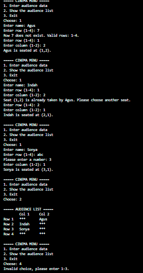

### Pertanyaan Diskusi Percobaan 2

**Input huruf pada prompt baris (`InputMismatchException`).**
Program dasar `CinemaWithScanner20` dijalankan dengan memasukkan `abc` pada `Enter row`:

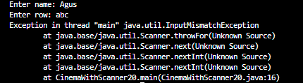

`nextInt()` hanya menerima token berbentuk bilangan bulat; jika bukan, ia melempar `InputMismatchException` dan program berhenti. Penanganannya: periksa dulu dengan `sc.hasNextInt()` sebelum memanggil `nextInt()`; bila `false`, buang token yang salah dengan `sc.next()` dan minta input lagi. Cara ini dipakai pada `CinemaMenu20` (pesan `Please enter a number:`). Alternatif lain: membaca baris sebagai `String` lalu mengubahnya dengan `Integer.parseInt()` di dalam `try-catch`.

**Jika jumlah baris dan kolom ditentukan saat program berjalan, bagian mana yang harus diubah?**
Deklarasi array: `new String[4][2]` diganti `new String[numRows][numCols]` setelah kedua nilai dibaca dari `Scanner`. Semua batas pengecekan dan loop harus memakai `audience.length` dan `audience[i].length`, bukan angka tetap. Array tetap tidak bisa berubah ukurannya setelah dibuat, karena panjangnya ditetapkan sekali saat instansiasi (blok memori dialokasikan dengan ukuran tertentu dan `length` tidak bisa diubah); jika perlu ukuran baru, harus dibuat array baru.

---

## 6. Percobaan 3 — Array 2 Dimensi dengan Panjang Baris Berbeda (*Jagged Array*)

**File:** `src/percobaan3/Numbers20.java`

```java
import java.util.Arrays;

public class Numbers20 {
    public static void main(String[] args) {
        // Langkah 2: array 2 dimensi dengan panjang baris berbeda (jagged array)
        int[][] myNumbers = new int[3][];
        myNumbers[0] = new int[5];
        myNumbers[1] = new int[3];
        myNumbers[2] = new int[1];

        // Langkah 3: tampilkan tiap baris dengan Arrays.toString()
        for (int i = 0; i < myNumbers.length; i++) {
            System.out.println(Arrays.toString(myNumbers[i]));
        }
    }
}
```

**Hasil eksekusi**

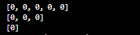

Sesuai *checkpoint*: `[0, 0, 0, 0, 0]`, `[0, 0, 0]`, dan `[0]`. Semua elemen bernilai 0 karena nilai default `int` adalah 0.

### Jawaban Pertanyaan Percobaan 3

**1. Fungsi `Arrays.toString()`.**
Mengubah isi **array 1 dimensi** menjadi satu `String` berformat `[elemen1, elemen2, ...]` sehingga seluruh isi array dapat dicetak tanpa loop.

**2 dan 3. `Arrays.toString(myNumbers)` dibandingkan `Arrays.deepToString(myNumbers)`.**

File: `src/percobaan3/Numbers20Q2Q3.java`

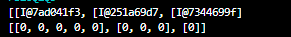

- `Arrays.toString(myNumbers)` menampilkan sesuatu seperti `[[I@2a139a55, [I@15db9742, [I@6d06d69c]`. `myNumbers` adalah array yang elemennya adalah **array `int`**; `toString()` hanya memanggil `toString()` bawaan tiap elemen, yaitu nama tipe (`[I` = array `int`) diikuti `@` dan kode hash alamat objek. Kode hash ini **berbeda tiap kali program dijalankan**.
- `Arrays.deepToString(myNumbers)` menelusuri array **secara rekursif** dan menghasilkan `[[0, 0, 0, 0, 0], [0, 0, 0], [0]]` dalam satu baris. Fungsi ini diperlukan karena array 2 dimensi berisi array lagi, sedangkan `toString()` hanya menelusuri satu tingkat. Berbeda dengan Code 16 yang mencetak tiap baris pada baris terpisah dengan loop.

**4. Nilai default elemen `int`.** `0`.

**5. Panjang tiap baris.**

File: `src/percobaan3/Numbers20Q5Q7.java`

```java
for (int i = 0; i < myNumbers.length; i++) {
    System.out.println("Length of row " + (i + 1) + ": " + myNumbers[i].length);
}
```

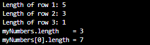

Hasil: baris 1 = 5, baris 2 = 3, baris 3 = 1, sesuai pembuatan masing-masing baris.

**6. Dapatkah panjang array diubah setelah dibuat?**
Tidak. Panjang array ditetapkan saat instansiasi dan bersifat tetap. Yang bisa dilakukan hanyalah membuat array baru dengan ukuran lain (dan menyalin isi lama bila perlu).

**7. Setelah `myNumbers[0] = new int[7];`, nilai mana yang berubah?**

Hasilnya (gambar di atas): `myNumbers.length` tetap **3**, sedangkan `myNumbers[0].length` menjadi **7**. Perintah tersebut tidak memperbesar array lama; ia membuat array `int` baru berukuran 7 lalu mengganti **referensi** pada posisi `myNumbers[0]`. Array luar (`myNumbers`) tetap berisi 3 baris, dan baris pertama lama tidak dirujuk lagi.

### Pertanyaan Diskusi Percobaan 3

File: `src/percobaan3/Numbers20Discussion.java`

```java
import java.util.Arrays;

public class Numbers20Discussion {
    public static void main(String[] args) {
        int[][] myNumbers = new int[3][];
        myNumbers[0] = new int[5];
        myNumbers[1] = new int[3];
        myNumbers[2] = new int[1];

        // 1) "Salinan" dengan penugasan biasa: hanya menyalin REFERENSI
        int[][] copy = myNumbers;
        copy[0][0] = 99;
        System.out.println("Assignment : myNumbers[0][0] = " + myNumbers[0][0]);
        myNumbers[0][0] = 0;   // kembalikan

        // 2) Salinan dalam (deep copy) dengan loop: tiap baris disalin
        int[][] deep = new int[myNumbers.length][];
        for (int i = 0; i < myNumbers.length; i++) {
            deep[i] = Arrays.copyOf(myNumbers[i], myNumbers[i].length);
        }
        deep[0][0] = 77;
        System.out.println("Deep copy  : myNumbers[0][0] = " + myNumbers[0][0] + ", deep[0][0] = " + deep[0][0]);

        // 3) clone() hanya salinan dangkal (shallow): baris-barisnya masih dipakai bersama
        int[][] cloned = myNumbers.clone();
        cloned[0][0] = 55;
        System.out.println("clone()    : myNumbers[0][0] = " + myNumbers[0][0] + ", cloned[0][0] = " + cloned[0][0]);

        cloned[1] = new int[]{1};   // mengganti baris di salinan saja
        System.out.println("clone()    : myNumbers[1].length = " + myNumbers[1].length
                + ", cloned[1].length = " + cloned[1].length);
    }
}
```


**Mengapa `myNumbers[0][0]` ikut berubah setelah `copy[0][0] = 99`?**
`int[][] copy = myNumbers;` **tidak menyalin isi array**, hanya menyalin *referensi*; `copy` dan `myNumbers` menunjuk ke objek array yang sama. Perubahan lewat `copy` otomatis terlihat lewat `myNumbers` (hasil: `99`). Menyalin nilai satu per satu dengan loop berbeda: dibuat array baru yang terpisah, sehingga perubahan pada salinan tidak memengaruhi aslinya.

**Cara menyalin array 2 dimensi dengan benar, dan apakah `clone()` cukup?**
Salinan dalam (*deep copy*) membuat array luar baru **dan** array baru untuk setiap baris:

```java
int[][] deep = new int[myNumbers.length][];
for (int i = 0; i < myNumbers.length; i++) {
    deep[i] = Arrays.copyOf(myNumbers[i], myNumbers[i].length);
}
```

Hasil uji: perubahan `deep[0][0] = 77` tidak memengaruhi `myNumbers` (tetap `0`). `clone()` **tidak cukup**: pada array 2 dimensi ia hanya salinan dangkal (*shallow copy*), array luar baru tetapi baris-barisnya masih dipakai bersama. Terbukti, `cloned[0][0] = 55` ikut mengubah `myNumbers[0][0]`. Namun mengganti seluruh baris pada salinan (`cloned[1] = new int[]{1}`) tidak memengaruhi aslinya karena yang diganti adalah referensi di array luar salinan.

---

## 7. Percobaan 4 — Studi Kasus SIAKAD

Seorang dosen memasukkan nilai tiga mata kuliah (Programming Fundamentals, Mathematics, CTPS) untuk 4 mahasiswa. Baris = mahasiswa, kolom = mata kuliah.

**File:** `src/percobaan4/SIAKAD20.java` (Langkah 1–5: input dengan *nested loop*, rata-rata tiap mahasiswa, rata-rata tiap mata kuliah)

```java
import java.util.Scanner;

public class SIAKAD20 {
    public static void main(String[] args) {
        Scanner sc = new Scanner(System.in);
        int[][] scores = new int[4][3];   // 4 mahasiswa (baris) x 3 mata kuliah (kolom)

        // Langkah 3 + 4: input nilai dengan nested loop dan rata-rata per mahasiswa
        for (int i = 0; i < scores.length; i++) {
            System.out.println("Enter scores for student no. " + (i + 1));
            double totalPerStudent = 0;

            for (int j = 0; j < scores[i].length; j++) {
                System.out.print("Score for course " + (j + 1) + ": ");
                scores[i][j] = sc.nextInt();
                totalPerStudent += scores[i][j];
            }

            System.out.println("Average score: " + totalPerStudent / scores[i].length);
        }

        // Langkah 5: rata-rata per mata kuliah (jumlah kolom, dibagi jumlah mahasiswa)
        System.out.println("\n========================================");
        System.out.println("Average score of each course:");

        for (int j = 0; j < scores[0].length; j++) {
            double totalPerCourse = 0;

            for (int i = 0; i < scores.length; i++) {
                totalPerCourse += scores[i][j];
            }

            System.out.println("Course " + (j + 1) + ": " + totalPerCourse / scores.length);
        }
    }
}
```

**Hasil eksekusi** (data uji: M1 = 80, 75, 90; M2 = 70, 85, 65; M3 = 90, 95, 100; M4 = 60, 70, 80)

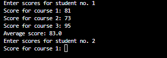

**Pembuktian *checkpoint* (hitung manual rata-rata per mata kuliah):**

| Mata kuliah | Perhitungan | Hasil manual | Hasil program |
|---|---|---|---|
| 1 | (80 + 70 + 90 + 60) / 4 = 300 / 4 | 75.0 | 75.0 |
| 2 | (75 + 85 + 95 + 70) / 4 = 325 / 4 | 81.25 | 81.25 |
| 3 | (90 + 65 + 100 + 80) / 4 = 335 / 4 | 83.75 | 83.75 |

Rata-rata per mahasiswa juga cocok: M1 = 245 / 3 = 81.67, M2 = 220 / 3 = 73.33, M3 = 285 / 3 = 95.0, M4 = 210 / 3 = 70.0.

Pembagi rata-rata per mahasiswa memakai `scores[i].length` (bukan angka tetap `3`), dan pembagi rata-rata per mata kuliah memakai `scores.length`, sesuai peringatan jobsheet.

### Jawaban Pertanyaan Percobaan 4

**1. Jumlah mahasiswa dan mata kuliah ditentukan saat program berjalan.**

File: `src/percobaan4/SIAKADDynamic20.java`. Perubahan utamanya:

```java
int numStudents;
do {
    System.out.print("Enter the number of students: ");
    numStudents = sc.nextInt();
} while (numStudents <= 0);

int numCourses;
do {
    System.out.print("Enter the number of courses: ");
    numCourses = sc.nextInt();
} while (numCourses <= 0);

int[][] scores = new int[numStudents][numCourses];   // ukuran ditentukan saat runtime
```

Semua loop memakai `scores.length`, `scores[i].length`, dan `scores[0].length`, tanpa angka tetap. Pengujian dengan 3 mahasiswa dan 2 mata kuliah (setelah nilai `0` ditolak):

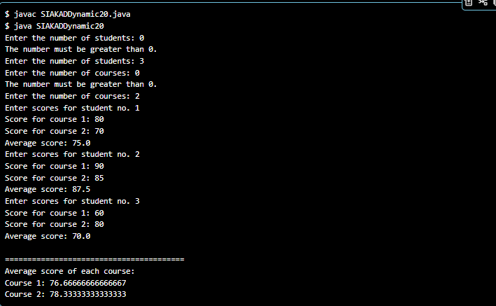

Rata-rata: 75.0, 87.5, 70.0 per mahasiswa dan 76.67, 78.33 per mata kuliah, cocok dengan hitungan manual ((80+90+60)/3 dan (70+85+80)/3).

### Pertanyaan Diskusi Percobaan 4

File: `src/percobaan4/SIAKAD20Discussion.java` (data tetap yang sama dengan uji di atas)

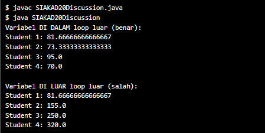

**Jika `totalPerStudent` dipindah ke luar loop.**
Variabel tidak lagi di-reset ke 0 untuk setiap mahasiswa, sehingga totalnya **menumpuk** dari mahasiswa sebelumnya. Hasil percobaan: rata-rata mahasiswa 2 menjadi 155.0 (seharusnya 73.33), mahasiswa 3 menjadi 250.0 (seharusnya 95.0), dan mahasiswa 4 menjadi 320.0 (seharusnya 70.0). Hanya mahasiswa pertama yang benar. Contoh: mahasiswa 2 dihitung (245 + 220) / 3 = 155.0. Deklarasi di dalam loop luar membuat variabel dibuat ulang dengan nilai 0 pada tiap putaran.

**Nilai yang belum diisi (default 0) dan pengaruhnya pada rata-rata.**
Nilai default 0 ikut terhitung sebagai nilai asli dan menurunkan rata-rata. Contoh: nilai 80 dan 90 dengan satu nilai belum diinput menghasilkan (80 + 90 + 0) / 3 = 56.67, padahal rata-rata nilai yang sudah masuk adalah 85.0. Program sebaiknya membedakan "belum diisi" dari "nilai 0", misalnya memakai nilai penanda seperti `-1`, `Integer[][]` (dengan `null` untuk belum diisi), atau array `boolean[][]` tambahan penanda; kemudian rata-rata hanya dihitung dari nilai yang sudah terisi.

---

## 8. Tugas Mandiri — Survei 10 Responden × 6 Pertanyaan

> Soal meminta mengimplementasikan *flowchart* survei dari slide teori. Slide tersebut tidak ada pada berkas yang saya terima, sehingga program disusun mengikuti **empat persyaratan tertulis pada jobsheet**: simpan hasil dalam array 2 dimensi, tampilkan rata-rata tiap responden, rata-rata tiap pertanyaan, dan rata-rata keseluruhan.

**File:** `src/tugas/Survey20.java`

Rancangan program:
- `survey[10][6]`: **baris = responden, kolom = pertanyaan**, nilai jawaban 1–5.
- Jumlah responden dan pertanyaan disimpan dalam konstanta `NUM_RESPONDENTS` dan `NUM_QUESTIONS` sesuai *Catatan Konsep*; semua loop memakai batas dari `length`.
- Input divalidasi: jawaban di luar 1–5 ditolak, dan input non-angka diulang.
- Rata-rata responden = jumlah satu baris / jumlah pertanyaan; rata-rata pertanyaan = jumlah satu kolom / jumlah responden; rata-rata keseluruhan = seluruh jawaban / (10 × 6).

```java
import java.util.Locale;
import java.util.Scanner;

public class Survey20 {
    public static void main(String[] args) {
        final int NUM_RESPONDENTS = 10;
        final int NUM_QUESTIONS = 6;

        Scanner sc = new Scanner(System.in);
        int[][] survey = new int[NUM_RESPONDENTS][NUM_QUESTIONS];   // baris = responden, kolom = pertanyaan

        // 1. Simpan hasil survei ke array 2 dimensi (jawaban 1-5, divalidasi)
        for (int i = 0; i < survey.length; i++) {
            System.out.println("Respondent " + (i + 1));
            for (int j = 0; j < survey[i].length; j++) {
                int answer;
                do {
                    System.out.print("  Question " + (j + 1) + " (1-5): ");
                    while (!sc.hasNextInt()) {
                        System.out.print("  Please enter a number (1-5): ");
                        sc.next();
                    }
                    answer = sc.nextInt();
                    if (answer < 1 || answer > 5) {
                        System.out.println("  The answer must be between 1 and 5.");
                    }
                } while (answer < 1 || answer > 5);
                survey[i][j] = answer;
            }
        }

        // Tabel hasil survei
        System.out.println();
        System.out.println("===== SURVEY RESULTS =====");
        System.out.printf("%-14s", "");
        for (int j = 0; j < NUM_QUESTIONS; j++) {
            System.out.printf("%-5s", "Q" + (j + 1));
        }
        System.out.println();
        for (int i = 0; i < survey.length; i++) {
            System.out.printf("%-14s", "Respondent " + (i + 1));
            for (int j = 0; j < survey[i].length; j++) {
                System.out.printf("%-5d", survey[i][j]);
            }
            System.out.println();
        }

        // 2. Rata-rata tiap responden (jumlah baris / jumlah pertanyaan)
        int grandTotal = 0;
        System.out.println();
        System.out.println("===== AVERAGE PER RESPONDENT =====");
        for (int i = 0; i < survey.length; i++) {
            int totalPerRespondent = 0;
            for (int j = 0; j < survey[i].length; j++) {
                totalPerRespondent += survey[i][j];
            }
            grandTotal += totalPerRespondent;
            System.out.printf(Locale.US, "Respondent %d: %.2f%n", i + 1,
                    (double) totalPerRespondent / survey[i].length);
        }

        // 3. Rata-rata tiap pertanyaan (jumlah kolom / jumlah responden)
        System.out.println();
        System.out.println("===== AVERAGE PER QUESTION =====");
        for (int j = 0; j < survey[0].length; j++) {
            int totalPerQuestion = 0;
            for (int i = 0; i < survey.length; i++) {
                totalPerQuestion += survey[i][j];
            }
            System.out.printf(Locale.US, "Question %d: %.2f%n", j + 1,
                    (double) totalPerQuestion / survey.length);
        }

        // 4. Rata-rata keseluruhan
        System.out.println();
        System.out.println("===== OVERALL AVERAGE =====");
        System.out.printf(Locale.US, "Overall average: %.2f%n",
                (double) grandTotal / (NUM_RESPONDENTS * NUM_QUESTIONS));
    }
}
```

**Hasil eksekusi** (60 jawaban uji; pada responden 2 pertanyaan 3 sempat dimasukkan `7` yang ditolak, dan pada responden 5 pertanyaan 1 sempat dimasukkan `abc` yang ditolak)

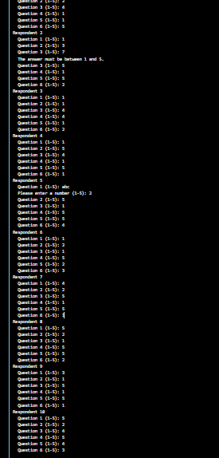

*Checkpoint* terpenuhi: program menerima 10 × 6 jawaban lalu menampilkan 10 rata-rata responden, 6 rata-rata pertanyaan, dan 1 rata-rata keseluruhan (2.97). Seluruh angka rata-rata telah dicocokkan dengan perhitungan terpisah di luar program dan hasilnya sama.

---

## 9. Refleksi

**1. Dua situasi nyata yang dapat dimodelkan dengan array 2 dimensi.**
- **Denah kursi bioskop/kelas:** baris = nomor baris kursi, kolom = nomor kursi pada baris itu; isi elemen = nama penonton (atau `null` bila kosong). Ini dipakai pada Percobaan 1–2.
- **Tabel nilai (SIAKAD):** baris = mahasiswa, kolom = mata kuliah; isi elemen = nilai. Rata-rata per baris adalah rata-rata mahasiswa, rata-rata per kolom adalah rata-rata mata kuliah. Contoh lain: piksel gambar (baris = koordinat y, kolom = x) atau papan catur.

**2. Perbedaan array 2 dimensi persegi dan *jagged array*.**
Pada array persegi (*rectangular*) semua baris memiliki jumlah kolom yang sama, dibuat dengan `new int[baris][kolom]`. Pada *jagged array* tiap baris dibuat sendiri dan boleh memiliki panjang berbeda (`new int[3][]`, lalu `a[0] = new int[5]`, dan seterusnya).
- Contoh array persegi: denah kursi bioskop atau tabel nilai (semua mahasiswa mengambil jumlah mata kuliah yang sama).
- Contoh *jagged*: jumlah kelas per hari dalam jadwal kuliah (Senin 4 kelas, Selasa 2 kelas, Rabu 1 kelas), atau segitiga Pascal. Memakai array persegi untuk data seperti ini memboroskan memori dengan sel kosong.

**3. Bagian yang paling rentan terhadap kesalahan indeks dan cara mencegahnya.**
Kesalahan indeks paling rentan terjadi pada: (a) konversi nomor kursi yang dilihat pengguna (mulai dari 1) ke indeks array (mulai dari 0), yaitu `audience[row - 1][col - 1]`; (b) batas loop, misalnya memakai `<=` atau tertukar antara `array.length` dan `array[i].length`; dan (c) mengakses elemen/baris `null`. Pencegahannya: selalu memakai `.length` (bukan angka tetap), memvalidasi rentang nomor sebelum mengakses array, menyadari bahwa nomor pengguna dan indeks array berbeda satu angka, memberi nama variabel yang jelas (`row`, `col`), serta menguji kasus batas (baris terakhir, kolom 0, kursi terisi).

---

## 10. Kesimpulan

1. Array 2 dimensi adalah array yang berisi array; `arr.length` memberi jumlah baris dan `arr[i].length` memberi jumlah kolom baris ke-`i`, sehingga kode yang memakai `length` otomatis menyesuaikan ukuran data.
2. Elemen yang belum diisi bernilai default (`null` untuk `String`, `0` untuk `int`); data `null` perlu ditangani agar tidak menimbulkan `NullPointerException`, dan nilai 0 yang belum diisi dapat merusak rata-rata.
3. *Nested loop* adalah pola utama pemrosesan array 2 dimensi: loop luar untuk baris dan loop dalam untuk kolom. Rata-rata per baris dan per kolom hanya berbeda pada urutan loop dan pembaginya.
4. *Jagged array* mengizinkan panjang baris berbeda; array tidak bisa diperbesar setelah dibuat, "memperbesar" berarti membuat array baru, dan menyalin array 2 dimensi harus dengan *deep copy* karena `=` dan `clone()` tidak menyalin baris-barisnya.
5. Validasi input (rentang indeks, kursi terisi, input non-angka) membuat program lebih kokoh dan menghindari `ArrayIndexOutOfBoundsException` dan `InputMismatchException`.

## Lampiran

### Struktur folder

```text
Laporan_Jobsheet11_20/
├── Laporan_Jobsheet11.md
├── src/
│   ├── percobaan1/   Cinema20, ...Q2, ...Q4, ...Q6Q7, ...Q8Q10, ...Discussion
│   ├── percobaan2/   CinemaWithScanner20, CinemaMenu20
│   ├── percobaan3/   Numbers20, ...Q2Q3, ...Q5Q7, ...Discussion
│   ├── percobaan4/   SIAKAD20, SIAKADDynamic20, SIAKAD20Discussion
│   └── tugas/        Survey20
└── image/            tangkapan layar hasil eksekusi (.png)
```

### Catatan

- Seluruh program telah dikompilasi dan dijalankan (JDK 21) dengan input contoh; keluaran pada laporan berasal dari eksekusi tersebut. Kode hash pada Percobaan 3 pertanyaan 2 akan berbeda pada setiap eksekusi.
- Gambar di folder `image/` adalah render tampilan terminal dari keluaran asli program. Jika dosen mewajibkan tangkapan layar dari laptop sendiri, ganti file gambar dengan nama yang sama.
