# Lab Report: Jobsheet 8, Loops 2

## Identity

| Item | Detail |
|---|---|
| Name | [NAME] |
| Student number | [STUDENT NUMBER] |
| Class | [CLASS] |
| Course | [COURSE NAME] |
| Lecturer | [LECTURER NAME] |
| Practicum date | [DATE] |

## Objectives

- Understand what a nested loop is in an algorithm.
- Understand how a nested loop runs, step by step.
- Know the syntax of a nested loop.
- Use nested loops to solve a simple case study.

## Brief Theory

A loop repeats a block of code. A `for` loop fits when we know how many times to repeat. A `while` loop repeats as long as its condition is true, and it checks the condition before each round. A `do-while` loop runs the block once first and checks the condition after, so it works well for input checks.

A nested loop is a loop inside another loop. The outer loop starts one round, and the inner loop then runs all its rounds. After that, the outer loop moves to its next round.

A counter variable counts steps. An accumulator variable adds up values, such as a total score.

## Tools and Materials

- A computer with a Java compiler (JDK)
- Visual Studio Code
- Git and a GitHub account, with the repository `daspro-jobsheet8`
- The jobsheet: Jobsheet 8, Loops 2 (Programming Fundamentals 2026)

## Work Steps

### Experiment 1: Review of Loops 1

I created the repository `daspro-jobsheet8` and the file `StarStudentNo.java`. The program reads a number `n` with `Scanner`. A `for` loop then prints the character `*` `n` times side by side. After the loop, `println()` moves the cursor to a new line.

**File: StarStudentNo.java**

```java
import java.util.Scanner;

public class StarStudentNo {
    public static void main(String[] args) {
        Scanner sc = new Scanner(System.in);
        System.out.print("Enter the value of n = ");
        int n = sc.nextInt();

        for (int i = 1; i <= n; i++) {
            System.out.print("*");
        }
        System.out.println();
        sc.close();
    }
}
```

How the code works:

- `Scanner sc` reads the number typed on the keyboard.
- The `for` loop runs with `i` from 1 to `n`, so it runs `n` times.
- `print` keeps the stars on one line. `println()` ends the line.

Results from the jobsheet steps 9 and 10 (the number of stars matches the number of rounds):

| Input n | Stars printed |
|---|---|
| 5 | 5 |
| 3 | 3 |
| 7 | 7 |

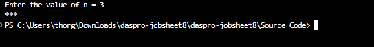

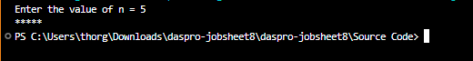


### Experiment 2: Rectangle Star Pattern (Nested FOR)

I created `RectangleStudentNo.java`. The program reads `rows` and `columns`. The inner loop prints one row of stars. The outer loop repeats that row `rows` times. A `println()` after the inner loop starts a new line for each row.

**File: RectangleStudentNo.java**

```java
import java.util.Scanner;

public class RectangleStudentNo {
    public static void main(String[] args) {
        Scanner sc = new Scanner(System.in);
        System.out.print("Enter the number of rows: ");
        int rows = sc.nextInt();
        System.out.print("Enter the number of columns: ");
        int columns = sc.nextInt();

        for (int i = 1; i <= rows; i++) {
            for (int j = 1; j <= columns; j++) {
                System.out.print("*");
            }
            System.out.println();
        }
        sc.close();
    }
}
```

How the code works:

- The outer loop (`i`) controls the rows.
- The inner loop (`j`) controls the columns.
- For each row, the inner loop runs `columns` times, then `println()` ends the row.

Results from the jobsheet steps 5, 8, and 9:

| Input (rows, columns) | Shape printed |
|---|---|
| Inner loop only, no outer loop (3, 6) | 1 line of 6 stars |
| (3, 6) | 3 lines of 6 stars |
| (4, 2) | 4 lines of 2 stars |
| (1, 5) | 1 line of 5 stars |

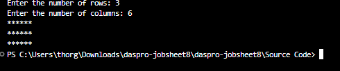

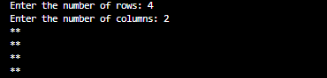


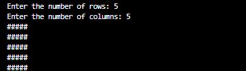

### Experiment 3: Debugging a Star Triangle (Nested WHILE)

I typed the starter code from the jobsheet. It does not print a triangle. I ran it with `n = 3` and `n = 5`, added a debug line to see the value of `i`, and fixed the code one step at a time. Then I added a second nested `while` for an inverted triangle.

**File: TriangleStudentNo.java (starter code)**

```java
import java.util.Scanner;

public class TriangleStudentNo {
    public static void main(String[] args) {
        Scanner sc = new Scanner(System.in);
        System.out.print("Enter the value of n = ");
        int n = sc.nextInt();

        int i = 0;
        while (i <= n) {
            int j = 0;
            while (j < i) {
                System.out.print("*");
                j++;
            }
            i++;
        }
        sc.close();
    }
}
```

**File: TriangleStudentNo.java (final version with the fix and the inverted triangle)**

```java
import java.util.Scanner;

public class TriangleStudentNo {
    public static void main(String[] args) {
        Scanner sc = new Scanner(System.in);
        System.out.print("Enter the value of n = ");
        int n = sc.nextInt();

        // Triangle: the outer loop runs n times (i = 1 to n)
        int i = 1;
        while (i <= n) {
            int j = 0;
            while (j < i) {
                System.out.print("*");
                j++;
            }
            System.out.println();
            i++;
        }

        // Inverted triangle: the outer loop counts down from n to 1
        i = n;
        while (i >= 1) {
            int j = 0;
            while (j < i) {
                System.out.print("*");
                j++;
            }
            System.out.println();
            i--;
        }
        sc.close();
    }
}
```

What the starter code does:

- The outer loop starts at `i = 0` and runs while `i <= n`. This gives `n + 1` rounds, which is one round too many.
- When `i = 0`, the inner loop prints no stars.
- There is no `println()`, so every star lands on one line. With `n = 3` the output is 6 stars in a row. With `n = 5` it is 15 stars in a row.
- With the debug line added and `n = 5`, the output reads: `[i=0] [i=1] *[i=2] **[i=3] ***[i=4] ****[i=5] *****`.

Answers to the jobsheet step 5:

- a. The outer loop runs 6 times for `n = 5`. The target has 5 rows, so the numbers do not match.
- b. When `i = 0`, no star is printed.
- c. The program never prints a new line, so all stars stay on one line.

Fixes from the jobsheet step 6:

- a. Adding `System.out.println();` after the inner loop gives the triangle its lines. The first line is still empty, because `i = 0` prints no stars.
- b. Starting the outer loop at `i = 1` makes it run exactly `n` times, and the empty line disappears.

The inverted triangle uses a second nested `while` with `i = n;` (no `int`, because `i` already exists). The outer loop counts down from `n` to 1, and the inner loop prints `i` stars in each row.

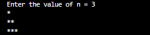

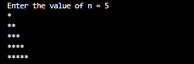

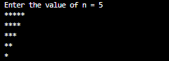

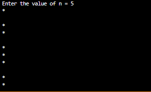


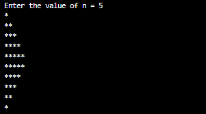

### Experiment 4: Case Study of Group Project Scores

I created `GroupScoreStudentNo.java`. The program reads the number of groups and graders. If either number is 0 or less, it prints an error message. Otherwise, three loops work together:

- A `while` loop (outer) goes through the groups.
- A `for` loop (middle) goes through the graders of one group.
- A `do-while` loop (inner) asks again when a score is outside 0 to 100.

After the graders finish, the program calculates the group average and compares it with `highestAverage`. At the end, it prints the best group and the highest average.

**File: GroupScoreStudentNo.java**

```java
import java.util.Scanner;

public class GroupScoreStudentNo {
    public static void main(String[] args) {
        Scanner sc = new Scanner(System.in);

        System.out.print("Enter the number of groups : ");
        int numGroups = sc.nextInt();
        System.out.print("Enter the number of graders: ");
        int numGraders = sc.nextInt();

        if (numGroups <= 0 || numGraders <= 0) {
            System.out.println("Groups and graders must be > 0.");
        } else {
            int groupNo = 1;                // outer loop counter
            double highestAverage = -1;     // -1: the first group is recorded
            int bestGroup = 0;

            while (groupNo <= numGroups) {
                System.out.println("Group " + groupNo);
                double totalScore = 0;

                for (int j = 1; j <= numGraders; j++) {
                    int score;
                    do {
                        System.out.print("  Score from Grader " + j + ": ");
                        score = sc.nextInt();
                        if (score < 0 || score > 100) {
                            System.out.println("  Score must be 0-100. Retry!");
                        }
                    } while (score < 0 || score > 100);
                    totalScore += score;
                }

                double averageScore = totalScore / numGraders;
                System.out.println("Group " + groupNo
                        + ": average score = " + averageScore);

                if (averageScore > highestAverage) {
                    highestAverage = averageScore;
                    bestGroup = groupNo;
                }

                groupNo++;
            }

            System.out.println("==============================");
            System.out.println("Best group          : " + bestGroup);
            System.out.println("Highest average     : " + highestAverage);
        }
        sc.close();
    }
}
```

How the code works:

- `groupNo` is the counter of the outer loop. `groupNo++` at the end of the loop body stops the loop.
- `totalScore` is set to 0 at the start of each group.
- `highestAverage` and `bestGroup` are declared before the outer loop, so they keep their values across groups.
- The `do-while` loop repeats the question while the score is below 0 or above 100.

Test cases from the jobsheet:

| Test | Expected behavior |
|---|---|
| 3 groups, 2 graders, with score 105 typed once | The program prints `Score must be 0-100. Retry!` and asks again. Best group is 3 with average 93.0 for the jobsheet sample scores. |
| 2 groups, 3 graders | The program prints an average for each group and the best group. |
| 0 groups | The program prints `Groups and graders must be > 0.` |

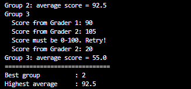

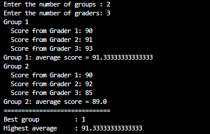

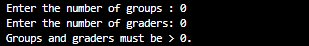

### Assignment 1: Nested Number Pattern

The program reads `n` (at least 1). Row 1 prints `1`, row 2 prints `1 2`, and so on up to row `n`. At the end, the program prints how many numbers it printed. For `n = 5`, the jobsheet example shows 5 rows and the line `Total numbers printed: 15`.

**File: Task1StudentNo.java**

```java
import java.util.Scanner;

public class Task1StudentNo {
    public static void main(String[] args) {
        Scanner sc = new Scanner(System.in);
        System.out.print("Enter the value of n = ");
        int n = sc.nextInt();

        if (n < 1) {
            System.out.println("n must be at least 1.");
        } else {
            int count = 0;   // counts every number printed

            for (int i = 1; i <= n; i++) {
                for (int j = 1; j <= i; j++) {
                    System.out.print(j);
                    if (j < i) {
                        System.out.print(" ");
                    }
                    count++;
                }
                System.out.println();
            }
            System.out.println("Total numbers printed: " + count);
        }
        sc.close();
    }
}
```


### Assignment 2: Multiplication Table

The program reads `n` (at least 3) and prints an `n × n` multiplication table with nested loops. Each cell holds the row number times the column number, aligned to the right. At the end, the program prints the sum of all numbers. For `n = 4`, the jobsheet example shows the sum `100`.

**File: Task2StudentNo.java**

```java
import java.util.Scanner;

public class Task2StudentNo {
    public static void main(String[] args) {
        Scanner sc = new Scanner(System.in);
        System.out.print("Enter the value of n = ");
        int n = sc.nextInt();

        if (n < 3) {
            System.out.println("n must be at least 3.");
        } else {
            int sum = 0;   // adds up every number in the table

            for (int row = 1; row <= n; row++) {
                for (int col = 1; col <= n; col++) {
                    int result = row * col;
                    System.out.printf("%4d", result);
                    sum += result;
                }
                System.out.println();
            }
            System.out.println("Total of all numbers: " + sum);
        }
        sc.close();
    }
}
```


### Assignment 3: Sales Recap for Several Stores

The program reads the number of stores (at least 1). For each store, it reads the number of customers and the number of items each customer bought. Both values can be 0 but not negative. The program prints the customers and items for each store, the total items across all stores, and the store with the most items. When stores tie, it shows the smallest store number. For the jobsheet example, the output is 5 items for store 1, 7 items for store 2, 12 items in total, and store 2 as the winner.

**File: Task3StudentNo.java**

```java
import java.util.Scanner;

public class Task3StudentNo {
    public static void main(String[] args) {
        Scanner sc = new Scanner(System.in);
        System.out.print("Enter the number of stores: ");
        int numStores = sc.nextInt();

        if (numStores < 1) {
            System.out.println("The number of stores must be at least 1.");
        } else {
            int grandTotalItems = 0;
            int maxItems = -1;      // -1: the first store is always recorded
            int bestStore = 0;
            String summary = "";    // collects one line per store

            for (int s = 1; s <= numStores; s++) {
                System.out.println("Store " + s);

                int numCustomers;
                do {
                    System.out.print("  Number of customers: ");
                    numCustomers = sc.nextInt();
                    if (numCustomers < 0) {
                        System.out.println("  Must not be negative. Retry!");
                    }
                } while (numCustomers < 0);

                int storeItems = 0;
                for (int c = 1; c <= numCustomers; c++) {
                    int items;
                    do {
                        System.out.print("  Items bought by customer " + c + ": ");
                        items = sc.nextInt();
                        if (items < 0) {
                            System.out.println("  Must not be negative. Retry!");
                        }
                    } while (items < 0);
                    storeItems += items;
                }

                summary += "Store " + s + " - customers: " + numCustomers
                        + ", total items: " + storeItems + "\n";
                grandTotalItems += storeItems;

                if (storeItems > maxItems) {   // ">" keeps the smallest store number on a tie
                    maxItems = storeItems;
                    bestStore = s;
                }
            }

            System.out.println();
            System.out.print(summary);
            System.out.println("Total items across all stores: " + grandTotalItems);
            System.out.println("Store with the most items: " + bestStore);
        }
        sc.close();
    }
}
```


## Answers to Questions

### Experiment 1

**1. If `i = 1` is changed to `i = 0` and the condition stays the same, how many `*` are printed when n = 5?**

The loop prints 6 stars. `i` takes the values 0, 1, 2, 3, 4, and 5, which is 6 rounds.

**2. If the condition `i <= n` is changed to `i < n`, how many times does the loop run when n = 5? Why is the result different?**

The loop runs 4 times, with `i` = 1, 2, 3, and 4. The value `i = 5` no longer passes the condition, so one round is lost.

**3. Predict the output of the code fragment when n = 9. Then change it to print the odd positive numbers up to n.**

The fragment starts at 2 and adds 2 each round. For `n = 9`, it prints `2 4 6 8`. The next value is 10, which is larger than 9, so the loop stops.

To print odd numbers, start at 1: `for (int i = 1; i <= n; i += 2)`. For `n = 9`, it prints `1 3 5 7 9`.

**4. Why does `i--` make the loop run endlessly?**

`i` starts at 1 and gets smaller each round. A smaller `i` is always less than or equal to a positive `n`, so the condition stays true. The loop would stop only after the `int` value wraps around, which takes billions of rounds.

### Experiment 2

**1. What do the variables `i` and `j` do?**

`i` is the counter of the outer loop and tracks the current row. `j` is the counter of the inner loop and tracks the current column in that row.

**2. For rows = 4 and columns = 7, how many times do the outer loop, the inner loop, and `print("*")` run?**

- The outer loop runs 4 times.
- The inner loop runs 7 times for each row, so 28 times in total.
- `print("*")` runs 28 times.

**3. What happens if the bounds are swapped, with rows = 3 and columns = 6?**

The outer loop then runs 6 times and the inner loop runs 3 times per round. The output becomes 6 lines of 3 stars instead of 3 lines of 6 stars.

**4. What is the effect of removing `System.out.println();` after the inner loop?**

The program never moves to a new line. All stars appear on one line. For 3 rows and 6 columns, that is 18 stars in a row.

**5. Change the printed character to `#`.**

Replace `System.out.print("*");` with `System.out.print("#");`. Then commit and push the file to GitHub.

### Experiment 3

**1. What are the mismatches in the initial output, and which two fixes produce the triangle?**

The mismatches are:

- All stars sit on one line.
- The outer loop runs `n + 1` times.
- The first round prints no stars.

Two fixes are:

- Add `System.out.println();` after the inner loop.
- Start the outer loop at `i = 1` so it runs `n` times.

**2. What do `i` and `j` do? Why must `j` be reset to 0 in every round of the outer loop? What happens without a reset?**

`i` is the current row number. `j` counts the stars printed in that row. `j` must start at 0 in each row so the inner loop can print `i` stars again. Without the reset, `j` keeps the old value. After the first row, each row then prints only 1 star.

**3. Which changes in the outer loop form the inverted triangle?**

- Initialization: `i` starts at `n` instead of 1.
- Condition: the loop runs while `i >= 1` (or `i > 0`).
- Update: `i--` replaces `i++`, so the row gets shorter each round.

### Experiment 4

**1. Why must `totalScore` be reset in the outer loop, but `highestAverage` must not?**

Each group needs its own total, so `totalScore` goes back to 0 for every group. `highestAverage` must remember the best average of all earlier groups to compare with the next group.

**2. For 3 groups and 2 graders with no invalid input, how many times does the body of the `for` loop run?**

It runs 6 times in total: 2 times for each of the 3 groups.

**3. What happens if `totalScore` is an `int` and the average uses integer division?**

The division drops the decimal part. For example, scores 85 and 90 give a total of 175. Then `175 / 2` gives 87 instead of 87.5.

**4. Why does `highestAverage` start at -1 instead of 0?**

A real average can be 0. With a start value of 0, the test `averageScore > highestAverage` fails for a group whose average is 0. For example, if every grader gives 0 to every group, `bestGroup` stays 0 and no group is recorded. With -1, the first group always passes the test.

**5. Name each loop and its role.**

- `while` (outer): goes through the groups one by one.
- `for` (middle): goes through the graders of one group.
- `do-while` (inner): asks for the score again while it is outside 0 to 100.

## Conclusion

In this practicum, I used nested loops to print patterns and to solve a scoring problem. I learned that the outer loop controls the rows or groups and the inner loop controls the columns or graders. I also learned to reset counters and totals inside the outer loop and to keep values such as the highest average outside it. I practiced `for`, `while`, and `do-while` loops and fixed a faulty triangle program with a debug line.
