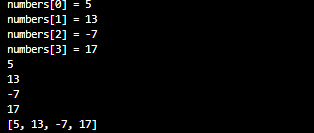
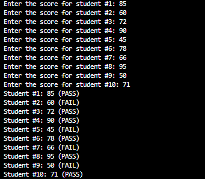
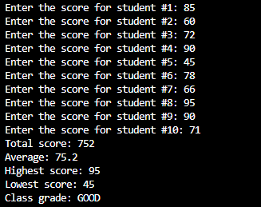
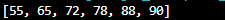
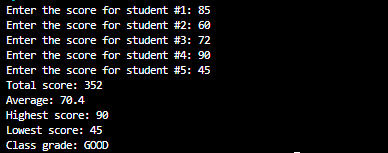
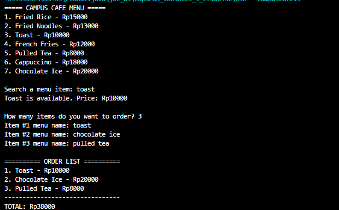

# Practical Report – Lab Sheet 9: One-Dimensional Arrays

**Course:** Programming Fundamentals 2026
**Program:** D4 Informatics Engineering – Politeknik Negeri Malang (Polinema)
**Name:** M. Thoriq Aadila D.  **Roll Number:** 01  **Class:** 1I

---

## 1. Objectives

After this lab, students are able to:

1. Understand one-dimensional arrays: how to declare, initialize, and access their elements in Java.
2. Write programs that store and process data in arrays using `for` and `foreach` loops.
3. Calculate the total, average, highest value, and lowest value of array elements.
4. Apply simple searching (linear search) and sorting (bubble sort) on arrays.
5. Solve case studies about campus life (student scores and a campus café).

---

## 2. Theoretical Summary

**What is an array?** An array stores many values of the **same type** in **one variable**. Each value is reached by its **index**. In Java, the size of an array is **fixed** after it is created.

**Declaring and initializing:**

```java
int[] numbers = new int[4];                 // empty array, 4 elements (default 0)
int[] numbers2 = {5, 13, -7, 17};           // values given directly
String[] menu = {"Fried Rice", "Pulled Tea"}; // array of String
```

**Index and length:**

- The first index is `0`, the last index is `length - 1`.
- `arr.length` is an *attribute* (no parentheses). `String` uses the *method* `length()`.
- Accessing an index outside the range causes `ArrayIndexOutOfBoundsException` (a runtime error).

| Type | Default value |
|---|---|
| `int`, `double` | `0` |
| `boolean` | `false` |
| `String` (object) | `null` |

**Ways to loop through an array:**

| Technique | Use |
|---|---|
| `for (int i = 0; i < arr.length; i++)` | Most flexible; has the index `i` |
| `for (int value : arr)` | Short; only for reading each value |
| `Arrays.toString(arr)` | Print the whole array in one line |
| `Arrays.sort(arr)` | Sort ascending |

**Common operations:** aggregation (total, average, max, min), **linear search** (check one by one), and **bubble sort** (compare two neighbors and swap).

| Operation | Time complexity |
|---|---|
| Access `arr[i]` | O(1) |
| Linear search | O(n) |
| Bubble sort | O(n²) |

**Array vs ArrayList:** an array has a fixed size and can store primitive types directly. An `ArrayList` can grow or shrink, but stores objects only (`Integer`, `Double`, ...).

---

## 3. Experiments

> Roll number used in file names: **01**. Compile with `javac FileName.java`, run with `java FileName`.

### 3.1 Experiment 1 – Declaring, Initializing, Filling, and Displaying Array Elements

**Source code:** [`sourcecode/NumberArray01.java`](sourcecode/NumberArray01.java)

```java
import java.util.Arrays;

public class NumberArray01 {
    public static void main(String[] args) {
        int[] numbers = new int[4];

        numbers[0] = 5;
        numbers[1] = 13;
        numbers[2] = -7;
        numbers[3] = 17;

        for (int i = 0; i < numbers.length; i++) {
            System.out.println("numbers[" + i + "] = " + numbers[i]);
        }

        for (int number : numbers) {
            System.out.println(number);
        }

        System.out.println(Arrays.toString(numbers));
    }
}
```

**Output:**



**How the program works:** `new int[4]` creates 4 empty boxes. We fill each box using its index. Then the `for` loop prints the index and value, the `foreach` loop prints only the values, and `Arrays.toString()` prints everything in one line.

#### Experiment 1 – Questions and Answers

**1. If the elements are changed to `5.0, 12867, 7.5, 2000000`, what happens? Why?**
The program **fails to compile** with the error `incompatible types: possible lossy conversion from double to int`. The array `numbers` is `int[]`, but `5.0` and `7.5` are `double` values with decimals. An `int` cannot keep decimals, so Java refuses it. To fix it, change the array type to `double[]`.

**2. Initialize the elements at the same time as the declaration.**

```java
int[] numbers = {5, 13, -7, 17};
```

The size is automatically 4 because there are 4 values.

**3. What is the output of the new display statement? What does it mean?**

```java
System.out.println("numbers[" + i + "] = " + numbers[i] + ", doubled = " + (numbers[i] * 2));
```

Output:

```
numbers[0] = 5, doubled = 10
numbers[1] = 13, doubled = 26
numbers[2] = -7, doubled = -14
numbers[3] = 17, doubled = 34
```

The statement prints the index, the value, and the value multiplied by 2. The parentheses around `(numbers[i] * 2)` make Java calculate the multiplication first, before joining it to the text.

**4. What if the loop condition is changed to `i <= 4`?**
The program prints 4 lines normally (index 0 to 3). When `i` becomes 4, it fails with:

```
Exception in thread "main" java.lang.ArrayIndexOutOfBoundsException: Index 4 out of bounds for length 4
```

The valid indexes are only 0 to 3 because the length is 4. Index 4 does not exist.

**5. Difference between `for`, `foreach`, and `Arrays.toString()`?**

| Method | When to use |
|---|---|
| `for` | When you need the index, want to change values, or compare with another element |
| `foreach` | When you only need to read each value (shorter code) |
| `Arrays.toString()` | When you just want to quickly see the whole array in one line (good for checking/debugging) |

---

### 3.2 Experiment 2 – SIAKAD Case Study: Entering Student Scores and Pass/Fail Status

**Source code:** [`sourcecode/ScoreArray01.java`](sourcecode/ScoreArray01.java)

```java
import java.util.Scanner;

public class ScoreArray01 {
    public static void main(String[] args) {
        int[] finalScores = new int[10];
        Scanner input = new Scanner(System.in);

        for (int i = 0; i < finalScores.length; i++) {
            System.out.print("Enter the score for student #" + (i + 1) + ": ");
            finalScores[i] = input.nextInt();
        }

        for (int i = 0; i < finalScores.length; i++) {
            String status = (finalScores[i] > 70) ? "PASS" : "FAIL";
            System.out.println("Student #" + (i + 1) + ": " + finalScores[i] + " (" + status + ")");
        }
        input.close();
    }
}
```

**Output** (input: 85, 60, 72, 90, 45, 78, 66, 95, 50, 71):



**How the program works:** The first loop reads 10 scores from the keyboard and stores them in the array. The second loop checks each score: if it is greater than 70 the status is `PASS`, otherwise `FAIL`. `(i + 1)` is used so the student number starts from 1, not 0.

#### Experiment 2 – Questions and Answers

**1. What does `i < finalScores.length` mean?**
The loop keeps running as long as `i` is smaller than the number of elements (10). So `i` goes from 0 to 9, which are exactly all valid indexes. When `i` becomes 10, the loop stops, so we never go outside the array.

**2. Display only the students who passed.**

```java
for (int i = 0; i < finalScores.length; i++) {
    if (finalScores[i] > 70) {
        System.out.println("Student #" + (i + 1) + ": " + finalScores[i] + " (PASS)");
    }
}
```

*Flow:* the loop visits every element. The `if` checks the score. If it is greater than 70, the line is printed. If not, the program skips it and goes to the next element.

**3. Change to `foreach`. Can all parts be converted?**

- **Input loop (step 4): cannot** be converted. A `foreach` variable is only a *copy* of the element value, so assigning to it does not change the array. We also need the index `i` to store each input in the right place.
- **Display loop (step 5): can** be converted, but `foreach` has no index. So we need an extra counter variable for the student number:

```java
int no = 1;
for (int score : finalScores) {
    String status = (score > 70) ? "PASS" : "FAIL";
    System.out.println("Student #" + no + ": " + score + " (" + status + ")");
    no++;
}
```

**4. Show the number of students who passed and failed.**

```java
int passed = 0;
int failed = 0;
for (int i = 0; i < finalScores.length; i++) {
    if (finalScores[i] > 70) {
        passed++;
    } else {
        failed++;
    }
}
System.out.println("Passed: " + passed);
System.out.println("Failed: " + failed);
```

With the sample data the result is **Passed: 6** and **Failed: 4**.

---

### 3.3 Experiment 3 – Arithmetic Operations on Arrays: Total, Average, Highest and Lowest Scores

**Source code:** [`sourcecode/AverageScoreArray01.java`](sourcecode/AverageScoreArray01.java)

```java
import java.util.Scanner;

public class AverageScoreArray01 {
    public static void main(String[] args) {
        Scanner input = new Scanner(System.in);

        int[] studentScores = new int[10];
        int total = 0;
        double average;

        for (int i = 0; i < studentScores.length; i++) {
            System.out.print("Enter the score for student #" + (i + 1) + ": ");
            studentScores[i] = input.nextInt();
            total += studentScores[i];
        }

        average = (double) total / studentScores.length;
        System.out.println("Total score: " + total);
        System.out.println("Average: " + average);

        int highest = studentScores[0];
        int lowest = studentScores[0];
        for (int i = 1; i < studentScores.length; i++) {
            if (studentScores[i] > highest) highest = studentScores[i];
            if (studentScores[i] < lowest) lowest = studentScores[i];
        }
        System.out.println("Highest score: " + highest);
        System.out.println("Lowest score: " + lowest);

        String category;
        if (average >= 85) {
            category = "EXCELLENT";
        } else if (average >= 70) {
            category = "GOOD";
        } else {
            category = "NEEDS IMPROVEMENT";
        }
        System.out.println("Class grade: " + category);
        input.close();
    }
}
```

**Output** (same data as Experiment 2):



**How the program works:**

- `total += studentScores[i]` adds every score into `total` while the scores are being entered.
- The average is `total / number of elements` = 712 / 10 = **71.2**.
- For highest and lowest, we start with the first element, then compare it with each next element and update the value when we find a bigger (or smaller) one.
- The average 71.2 is `>= 70` but `< 85`, so the class grade is **GOOD**.

#### Experiment 3 – Questions and Answers

**1. Display the number of students who passed (score > 70).**

```java
int passed = 0;
for (int i = 0; i < studentScores.length; i++) {
    if (studentScores[i] > 70) {
        passed++;
    }
}
System.out.println("Students passed: " + passed);
```

With the sample data the result is **6** students (85, 72, 90, 78, 95, 71).

**2. Accept the number of array elements from user input.**
Full code: [`sourcecode/questions/E3Q2.java`](sourcecode/questions/E3Q2.java). The important part is creating the array *after* we know the size:

```java
System.out.print("Enter the number of students: ");
int n = input.nextInt();
int[] studentScores = new int[n];
```

Then all loops use `studentScores.length` (or `n`) instead of the fixed number 10. Test with 4 students (80, 60, 75, 90): total 305, average 76.25, highest 90, lowest 60.

**3. Why `(double) total / studentScores.length` and not `total / studentScores.length`?**
`total` and `length` are both `int`. Dividing two `int` values gives an `int` result, so the decimal part is **cut off**. For example, `712 / 10` becomes `71`, not `71.2`. Writing `(double)` changes `total` to a decimal number first, so the division keeps the decimals and the answer becomes `71.2`.

---

### 3.4 Experiment 4 – Simple Searching and Sorting

#### Part A – Linear Search

**Source code:** [`sourcecode/ScoreSearch01.java`](sourcecode/ScoreSearch01.java)

```java
public class ScoreSearch01 {
    public static void main(String[] args) {
        int[] scores = {78, 65, 90, 55, 88, 72};
        int key = 90;
        boolean found = false;

        for (int i = 0; i < scores.length; i++) {
            if (scores[i] == key) {
                System.out.println("Score " + key + " was found at index " + i);
                found = true;
                break;
            }
        }
        if (!found) {
            System.out.println("Score " + key + " was not found.");
        }
    }
}
```

**Output** (running the current program with its default `key = 90`):


**How the program works:** the loop checks each element from the start. When `scores[i] == key`, it prints the index, sets `found = true`, and stops the loop with `break`. If the loop ends and `found` is still `false`, the value does not exist.

#### Part B – Bubble Sort

**Source code:** [`sourcecode/ScoreSort01.java`](sourcecode/ScoreSort01.java)

```java
import java.util.Arrays;

public class ScoreSort01 {
    public static void main(String[] args) {
        int[] scores = {78, 65, 90, 55, 88, 72};

        for (int i = 0; i < scores.length - 1; i++) {
            for (int j = 0; j < scores.length - 1 - i; j++) {
                if (scores[j] > scores[j + 1]) {
                    int temp = scores[j];
                    scores[j] = scores[j + 1];
                    scores[j + 1] = temp;
                }
            }
        }
        System.out.println(Arrays.toString(scores));
    }
}
```

**Output:**



#### Experiment 4 – Questions and Answers

**1. Meaning of `break;` in Part A.**
`break;` stops the loop immediately. Once the value is found, there is no need to check the remaining elements, so the program saves time.

**2. Accept the array size, the array contents, and the key from user input.**
Full code: [`sourcecode/questions/E4Q2.java`](sourcecode/questions/E4Q2.java).

```java
Scanner input = new Scanner(System.in);
System.out.print("Number of elements: ");
int n = input.nextInt();
int[] scores = new int[n];
for (int i = 0; i < n; i++) {
    System.out.print("Score #" + (i + 1) + ": ");
    scores[i] = input.nextInt();
}
System.out.print("Value to search: ");
int key = input.nextInt();
// ...then the same linear search loop as in Part A
```

**3. A more informative "not found" message.**

```java
if (!found) {
    System.out.println("The value you are looking for was not found: "
        + key + " is not in the array (checked " + scores.length + " elements).");
}
```

**4. How bubble sort works step by step** (data: `{78, 65, 90, 55, 88, 72}`).
Bubble sort compares two neighbors and swaps them if the left one is bigger. After each round, the biggest remaining number "floats" to the end.

| Round | Process | Array after the round |
|---|---|---|
| Start | – | `[78, 65, 90, 55, 88, 72]` |
| 1 | 78>65 swap; 78>90 no; 90>55 swap; 90>88 swap; 90>72 swap | `[65, 78, 55, 88, 72, 90]` |
| 2 | 65>78 no; 78>55 swap; 78>88 no; 88>72 swap | `[65, 55, 78, 72, 88, 90]` |
| 3 | 65>55 swap; 65>78 no; 78>72 swap | `[55, 65, 72, 78, 88, 90]` |
| 4 | 55>65 no; 65>72 no | `[55, 65, 72, 78, 88, 90]` |
| 5 | 55>65 no | `[55, 65, 72, 78, 88, 90]` |

The inner loop uses `scores.length - 1 - i` because the last `i` elements are already in their final place. The swap uses a temporary variable `temp` so no value is lost.

**5. Sort descending (largest to smallest).**
Change only the comparison from `>` to `<`:

```java
if (scores[j] < scores[j + 1]) {
```

Result: `[90, 88, 78, 72, 65, 55]`. Full code: [`sourcecode/questions/E4Q5.java`](sourcecode/questions/E4Q5.java).

---

## 4. Assignments

### 4.1 Assignment 1 – Managing Student Scores

**Source code:** [`sourcecode/StudentScores01.java`](sourcecode/StudentScores01.java)

```java
import java.util.Scanner;

public class StudentScores01 {
    public static void main(String[] args) {
        Scanner input = new Scanner(System.in);

        int n;
        do {
            System.out.print("Enter the number of student scores: ");
            n = input.nextInt();
            if (n <= 0) {
                System.out.println("The number must be greater than 0.");
            }
        } while (n <= 0);

        int[] scores = new int[n];
        int total = 0;

        for (int i = 0; i < scores.length; i++) {
            System.out.print("Enter the score for student #" + (i + 1) + ": ");
            scores[i] = input.nextInt();
            total += scores[i];
        }

        double average = (double) total / scores.length;

        int highest = scores[0];
        int lowest = scores[0];
        for (int i = 1; i < scores.length; i++) {
            if (scores[i] > highest) highest = scores[i];
            if (scores[i] < lowest) lowest = scores[i];
        }

        System.out.println();
        System.out.println("===== STUDENT SCORE REPORT =====");
        for (int i = 0; i < scores.length; i++) {
            String status = (scores[i] > 70) ? "PASS" : "FAIL";
            System.out.println("Student #" + (i + 1) + ": " + scores[i] + " (" + status + ")");
        }
        System.out.println("--------------------------------");
        System.out.println("Average       : " + average);
        System.out.println("Highest score : " + highest);
        System.out.println("Lowest score  : " + lowest);
        input.close();
    }
}
```

**Output** (5 students: 85, 60, 72, 90, 45):



**Explanation:**

- The program first asks for the number of scores and repeats the question if the number is 0 or negative (`do-while`).
- The array is created using that number, so its size is not fixed to 10.
- The total is collected while reading the scores, then the average is calculated with `(double)`.
- Highest and lowest use the comparison-variable technique from Experiment 3.
- The last loop prints every score with `PASS` (score > 70) or `FAIL`.

### 4.2 Assignment 2 – Campus Café Ordering Application

**Source code:** [`sourcecode/CampusCafe01.java`](sourcecode/CampusCafe01.java)

```java
import java.util.Scanner;

public class CampusCafe01 {

    // Linear search: returns the index of the menu item, or -1 if not found
    static int searchMenu(String[] menu, String name) {
        for (int i = 0; i < menu.length; i++) {
            if (menu[i].equalsIgnoreCase(name)) {
                return i;
            }
        }
        return -1;
    }

    public static void main(String[] args) {
        Scanner input = new Scanner(System.in);

        String[] menu = {"Fried Rice", "Fried Noodles", "Toast", "French Fries",
                         "Pulled Tea", "Cappuccino", "Chocolate Ice"};
        int[] prices = {15000, 13000, 10000, 12000, 8000, 18000, 20000};

        System.out.println("===== CAMPUS CAFE MENU =====");
        for (int i = 0; i < menu.length; i++) {
            System.out.println((i + 1) + ". " + menu[i] + " - Rp" + prices[i]);
        }
        System.out.println();

        // Menu search feature
        System.out.print("Search a menu item: ");
        String keyword = input.nextLine();
        int found = searchMenu(menu, keyword);
        if (found != -1) {
            System.out.println(menu[found] + " is available. Price: Rp" + prices[found]);
        } else {
            System.out.println("Sorry, \"" + keyword + "\" is not available.");
        }
        System.out.println();

        // Ordering feature
        System.out.print("How many items do you want to order? ");
        int count = input.nextInt();
        input.nextLine(); // clear the leftover newline

        String[] orders = new String[count]; // separate array for ordered names
        int total = 0;

        for (int i = 0; i < count; i++) {
            int index;
            do {
                System.out.print("Item #" + (i + 1) + " menu name: ");
                String name = input.nextLine();
                index = searchMenu(menu, name);
                if (index == -1) {
                    System.out.println("Menu not found, please try again.");
                }
            } while (index == -1);

            orders[i] = menu[index];
            total += prices[index];
        }

        System.out.println();
        System.out.println("========== ORDER LIST ==========");
        for (int i = 0; i < orders.length; i++) {
            int idx = searchMenu(menu, orders[i]);
            System.out.println((i + 1) + ". " + orders[i] + " - Rp" + prices[idx]);
        }
        System.out.println("--------------------------------");
        System.out.println("TOTAL: Rp" + total);
        input.close();
    }
}
```

**Output** (search "Toast", order 3 items, with one wrong menu name "Burger"):



**Explanation:**

- `menu` and `prices` are two arrays with the same order, so `prices[i]` is the price of `menu[i]`.
- `searchMenu()` is a **linear search**. It returns the index if the name is found, or `-1` if not. `equalsIgnoreCase` makes "toast" and "Toast" count as the same.
- In the ordering feature, a `do-while` loop repeats the question until the user types a valid menu name (validation).
- Ordered names are stored in a **separate** array `orders`, and the total price is accumulated at the same time.
- `input.nextLine()` after `nextInt()` clears the leftover Enter key, otherwise the next `nextLine()` would be skipped.
- At the end, the order list and the total cost are printed in a neat format.

---

## 5. Conclusion

1. An array stores many values of the same type in one variable, accessed by an index that starts at 0. The size is fixed after creation.
2. `for` loops are the most flexible way to process arrays; `foreach` is shorter but only good for reading.
3. Total, average, highest, and lowest values can be found by going through the elements once and keeping the result in a variable.
4. Linear search checks elements one by one (O(n)); bubble sort swaps neighbors until the array is ordered (O(n²)).
5. Arrays are useful for real cases such as student scores and café orders.

---

## 6. File Structure

```
Laporan_Jobsheet_9_Array_1_Dimensi.md
images/
    exp1_output.png ... exp4b_output.png, assignment1_output.png, assignment2_output.png
sourcecode/
    NumberArray01.java, ScoreArray01.java, AverageScoreArray01.java,
    ScoreSearch01.java, ScoreSort01.java,
    StudentScores01.java, CampusCafe01.java
    questions/  E3Q2.java, E4Q2.java, E4Q5.java
```
